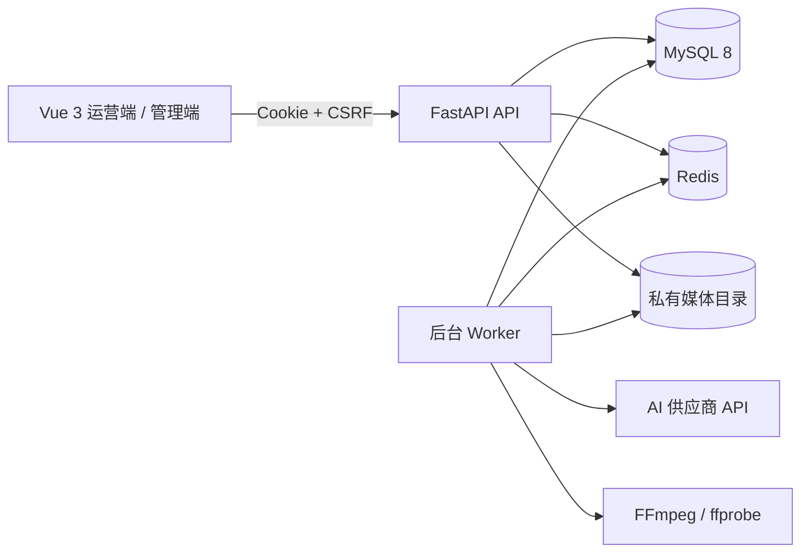

# 寰语（LinguaSphere）

面向内容团队的视频全球化工作台：从中文视频出发，统一完成语音识别、文本翻译、目标语言配音、字幕交付、图片生成与图生视频，并为管理员提供账号、供应商、任务、费用和审计管理能力。

> 项目定位：公司内部运营系统。账号由管理员创建，不提供公开注册；供应商密钥仅在服务端加密保存，浏览器不会回显明文。

## 核心能力

- **视频本地化**：上传源视频，一次生成一个或多个目标语言版本。
- **双翻译路径**：专业精译采用 ASR → 文本翻译 → TTS 的分段流水线；智能翻译采用同声传译生成译文与时间轴，再统一进行 TTS 配音。
- **字幕翻译**：对无口播、但画面内含烧录字幕的视频执行视觉字幕识别、翻译与配音。
- **声画交付**：移除中文原声，按时间轴合成目标语言配音；输出目标语言 SRT，并支持 WebVTT 外挂预览。
- **生成式内容**：支持文生图/参考图生图，以及首帧图片驱动的视频生成。
- **任务治理**：异步 Worker、任务租约、失败重试、人工取消、并发限制和任务级状态追踪。
- **运营后台**：账号与功能授权、供应商版本、价格规则、调用费用、任务和操作日志。
- **安全边界**：员工端与管理端采用独立登录入口和会话 Cookie，供应商凭据使用 AES-GCM 加密落库。

## 处理路径

| 路径 | 流程 | 适用场景 | 语言范围 |
| --- | --- | --- | --- |
| 专业精译（默认） | 录音文件 ASR → 火山方舟文本翻译 → MiniMax TTS → FFmpeg 合成 | 正式发布、需要逐段校对与稳定质量 | `en-US`、`ja-JP`、`ko-KR`、`vi-VN`、`ms-MY`、`th-TH`、`fil-PH`、`de-DE`、`fr-FR` |
| 智能翻译 | 有道大模型同传生成识别、译文与时间轴 → MiniMax TTS → FFmpeg 合成 | 快速获得翻译时间轴，同时复用统一配音链路 | 以有道应用实际开通语种和后台配置为准 |
| 字幕翻译 | 视觉模型识别画面字幕 → 文本翻译 → TTS → FFmpeg 合成 | 无口播、只有画面内字幕的视频 | 以文本翻译和 TTS 的交集为准 |

所有路径都保留原视频画面。成片不重复烧录字幕；目标语言字幕以独立 SRT 文件交付，前端预览时以 WebVTT 外挂显示。

## 系统架构



- API 负责认证、账号、上传、任务、配置、费用、审计和媒体下载。
- Worker 从 MySQL 状态机领取任务，并通过 Redis 租约避免重复执行。
- 原视频、音频、字幕和成片保存在私有目录，不由 Web 服务器直接暴露。
- 生产环境可由 FastAPI 同域托管 `frontend/dist`，也可将前端独立部署并配置 CORS。

详细说明见 [系统架构](docs/architecture.md)。

## 技术栈

| 层 | 技术 |
| --- | --- |
| 前端 | Vue 3、TypeScript、Vite、Pinia、Vue Router、Vitest |
| 后端 | Python 3.13、FastAPI、Pydantic、SQLAlchemy 2、Alembic |
| 数据 | MySQL 8.0+、Redis 7.2+（本地可使用 RESP2 兼容配置） |
| 媒体 | FFmpeg、ffprobe、分片上传、SRT/WebVTT |
| 外部能力 | 火山引擎豆包语音/方舟、MiniMax、有道智云 |

## 快速开始

### 1. 环境要求

- Python 3.13+
- Node.js 20+
- MySQL 8.0+
- Redis（生产要求 7.2+）
- FFmpeg 与 ffprobe（必须加入 `PATH`）
- 推荐安装 [uv](https://docs.astral.sh/uv/) 管理 Python 依赖

项目不依赖 Docker。

### 2. 安装依赖

```powershell
git clone https://github.com/Krive18/-AI-.git
Set-Location .\-AI-

Copy-Item .env.example backend/.env
py -3.13 -m uv sync --project backend --extra dev
npm --prefix frontend ci
```

`.env.example` 只包含本地开发占位值。生产部署必须按照 [部署上线指南](docs/deployment.md) 生成独立随机密钥，禁止复用示例值。

### 3. 初始化数据库

先创建 MySQL 数据库和最小权限应用账号，再执行：

```powershell
Set-Location backend
.venv\Scripts\alembic.exe upgrade head
.venv\Scripts\python.exe -m app.cli create-admin
Set-Location ..
```

`create-admin` 会在终端中交互式创建首个管理员账号。

### 4. 启动三个进程

```powershell
# 终端 1：API
Set-Location backend
.venv\Scripts\python.exe -m uvicorn app.main:create_app --factory --host 127.0.0.1 --port 8000
```

```powershell
# 终端 2：异步任务 Worker
Set-Location backend
.venv\Scripts\python.exe -m app.worker
```

```powershell
# 终端 3：前端
npm --prefix frontend run dev
```

访问地址：

- 员工端：<http://127.0.0.1:5173/login>
- 管理端：<http://127.0.0.1:5173/admin/login>
- API 文档（本地环境）：<http://127.0.0.1:8000/docs>

Vite 会将 `/api` 请求代理到 `127.0.0.1:8000`。

## 供应商配置

管理端“接口配置”内置 7 类能力预设：

| 能力 | `providerCode` | 默认用途 |
| --- | --- | --- |
| 语音识别 ASR | `doubao_asr` | 从源视频音轨生成分段文字与时间轴 |
| 文本翻译 | `ark` | 将分段原文翻译为目标语言 |
| 语音合成 TTS | `minimax` | 生成目标语言配音 |
| 一体化同声传译 | `youdao_si` | 生成识别文本、译文和时间轴，配音仍走 TTS |
| 图片生成 | `seedream` | 文生图、参考图生图 |
| 字幕识别 | `ark_vision` | 识别画面内烧录字幕 |
| 视频生成 | `seedance_video` | 以首帧图和描述词生成视频 |

“已启用”只代表配置参与路由，不代表远程服务已经可用。保存后必须点击“检查”，确认返回 `CONNECTED`；同时在供应商控制台核对模型开通、额度、区域和内容安全规则。

完整字段、默认端点、模型档位及错误排查见 [供应商配置与故障排查](docs/provider-configuration.md)。

## 质量与内容安全说明

- 翻译成片会静音中文原声，仅混入目标语言配音；分段音频会按原时间轴对齐。
- 目标字幕单独输出，避免原画已有字幕时发生双层字幕。
- 供应商可能拒绝真人肖像、敏感内容、无授权素材或不符合模型规范的参数；账户余额充足并不等于请求一定会通过。
- 图生视频当前支持 5、10、15 秒及 480P/720P；三个档位使用后台配置的模型 ID。
- 任何面向公开发布的成片都应经过人工复核，包括译文、发音、字幕时序、画面完整性和版权合规。

## 常用检查

```powershell
# 服务状态
scripts\check_local_services.ps1

# 后端
$env:PROVIDER_SECRET_ENCRYPTION_KEY = "MDEyMzQ1Njc4OWFiY2RlZjAxMjM0NTY3ODlhYmNkZWY=" # 仅测试
backend\.venv\Scripts\python.exe -m pytest backend/tests/unit -q
backend\.venv\Scripts\python.exe -m ruff check backend/app backend/tests
backend\.venv\Scripts\python.exe -m mypy backend/app

# 前端
npm --prefix frontend test
npm --prefix frontend run typecheck
npm --prefix frontend run lint
npm --prefix frontend run build
```

完整后端集成测试还要求设置 `AI_TRANSLATION_TEST_DATABASE_URL`、`AI_TRANSLATION_RUNTIME_TEST_DATABASE_URL` 和 `AI_TRANSLATION_GRANT_TEST_DATABASE_URL`。它们必须指向可清理的专用测试库及测试权限账号，**绝不能指向开发或生产数据库**；配置完成后再运行 `python -m pytest backend/tests -q`。

## 目录结构

```text
.
├─ backend/
│  ├─ app/
│  │  ├─ api/                 # API 聚合路由
│  │  ├─ core/                # 配置、数据库、Redis、安全与错误处理
│  │  ├─ modules/             # 认证、账号、任务、供应商、费用、生成能力
│  │  └─ workers/             # 翻译流水线与任务状态机
│  ├─ migrations/             # Alembic 迁移和最小权限 SQL 模板
│  └─ tests/                  # 后端单元与集成测试
├─ frontend/
│  ├─ src/components/         # 公共 UI 与供应商编辑器
│  ├─ src/views/operator/     # 员工端视频翻译工作台
│  ├─ src/views/admin/        # 管理后台
│  ├─ src/views/imagegen/     # 图片生成
│  └─ src/views/videogen/     # 图生视频
├─ docs/                      # 架构、部署、ADR 与运营文档
└─ scripts/                   # 本地服务检查脚本
```

## 安全约定

- 不要提交 `backend/.env`、真实 API Key、数据库口令、会话密钥或供应商加密密钥。
- 不要提交 `backend/.ai_translation_private/`、上传文件、成片、数据库备份或运行日志。
- 生产环境必须启用 HTTPS、`__Host-` Cookie、Redis 认证和私有存储权限隔离。
- 管理员保存的供应商凭据只进入专用密钥字段；`options` 仅允许非敏感运行参数。
- 如果密钥曾出现在聊天、截图、终端输出或 Git 历史中，应立即在供应商控制台轮换。

## 文档索引

- [系统架构](docs/architecture.md)
- [供应商配置与故障排查](docs/provider-configuration.md)
- [部署上线指南](docs/deployment.md)
- [运营使用说明](docs/功能使用说明（运营版）.md)
- [架构决策记录](docs/decisions/)

## 许可

仓库目前未附带开源许可证。除非仓库所有者另行授权，代码默认保留全部权利。
