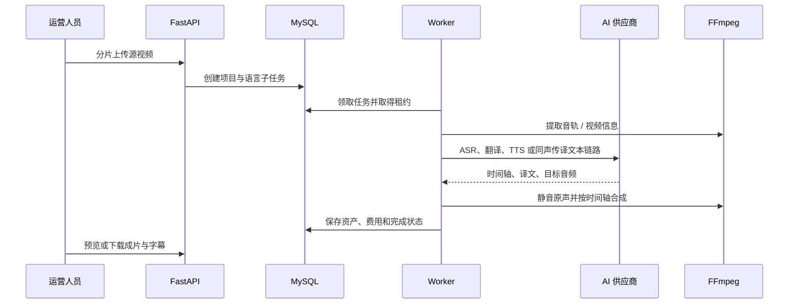

# 寰语系统架构

本文面向准备二次开发、部署或运维本项目的工程人员，描述当前代码中的真实组件边界和任务流。

## 1. 运行组件

| 组件 | 入口 | 职责 |
| --- | --- | --- |
| Web 前端 | `frontend/src/main.ts` | 员工端、管理端、Cookie 会话、任务轮询与媒体预览 |
| FastAPI API | `backend/app/main.py` | 认证、账号、上传、项目、供应商、费用、审计与媒体授权下载 |
| Worker | `backend/app/worker.py` | 领取翻译任务、调用供应商、执行 FFmpeg、记录用量与任务状态 |
| MySQL | SQLAlchemy + Alembic | 业务主数据、任务状态机、供应商版本、价格快照和审计记录 |
| Redis | 会话/租约相关组件 | 协调任务租约和运行期状态；生产使用 RESP3 |
| 私有文件目录 | `PRIVATE_STORAGE_ROOT` | 源视频、中间音频、字幕、成片及生成式媒体 |

API 与 Worker 是两个独立进程。只启动 API 时可以登录和创建任务，但任务不会被真正处理；Worker 必须常驻。

## 2. 前端路由与权限边界

- `/login`：员工登录。
- `/admin/login`：管理员登录。
- `/translations/*`：视频翻译工作台。
- `/imagegen`：图片生成。
- `/videogen`：图生视频；管理员可按账号授权。
- `/admin/*`：管理后台，覆盖运行概览、账号、任务、供应商、费用和日志。

员工端和管理端虽然由同一个 Vue 应用构建，但使用不同入口、角色守卫和会话 Cookie。后端接口继续执行角色校验，前端隐藏菜单不构成权限控制。

## 3. 翻译任务生命周期

任务按目标语言拆分。一个项目可以同时有多个语言子任务；单个语言失败不会伪装成项目成功。失败任务可由员工或管理员触发重试，重试次数和可重试状态由服务端约束。

## 4. 供应商路由

`provider_config` 保存稳定的逻辑能力与路由优先级，`provider_version` 保存不可变的端点、模型、非敏感参数和加密凭据版本。启用新版本时仅切换活动版本，历史任务和费用记录仍可追溯原版本。

当前能力枚举：

1. ASR
2. 文本翻译
3. TTS
4. 一体化同声传译
5. 图片生成
6. 字幕识别
7. 视频生成

运行时按照“能力、启用状态、优先级”选择配置。管理端的“检查”会发起真实最小请求，因此可能产生少量费用或创建短暂的远程任务。

## 5. 媒体与字幕策略

- 源文件和产物均在私有目录中，由鉴权接口按账号权限返回。
- 专业精译以识别时间轴为基准逐段翻译和配音。
- 合成阶段移除源视频中文原声，再放置目标语言音频，避免双语叠音。
- 字幕以 SRT 资产交付；在线预览按需转换为 WebVTT，不永久烧录到视频画面。
- FFmpeg/ffprobe 不可用、源媒体损坏或编码不受支持时，任务会在媒体阶段失败。

## 6. 安全设计

- 密码使用 Argon2 哈希；服务端不保存可逆密码。
- 员工会话与管理员会话分离，并使用 CSRF 防护写请求。
- 生产配置强制 HTTPS Cookie、显式 CORS、强随机会话密钥和 Redis RESP3。
- 供应商凭据经 `PROVIDER_SECRET_ENCRYPTION_KEY` 使用 AES-GCM 加密后入库。
- 前端只显示 `****`，API 不返回供应商密钥明文。
- 账号权限在 API 层验证；图片、视频和字幕下载不依赖可猜测的公开目录。

## 7. 数据迁移与兼容

数据库变更统一由 `backend/migrations/versions` 中的 Alembic 迁移管理。部署新版本前先备份数据库，再执行 `alembic upgrade head`。禁止手工修改生产表结构来绕过迁移。

本地开发允许 Redis RESP2 兼容配置；生产环境由配置校验强制 Redis 7.2+ 和 RESP3。相关决策见 `docs/decisions/`。

## 8. 扩展新供应商

增加供应商时应依次完成：

1. 在 `ProviderCapability` 中确认或新增能力类型。
2. 在运行时契约中实现对应方法，并统一抛出 `ProviderRequestError`。
3. 在 `ProviderRuntimeFactory` 注册稳定 `providerCode`。
4. 在管理端供应商编辑器增加预设和非敏感参数表单。
5. 为鉴权失败、超时、限流、无效响应和供应商拒绝添加测试。
6. 补充价格计量单位、用量映射和文档。

不要把供应商特定响应结构泄漏到业务层；业务层只依赖统一结果和统一错误码。
